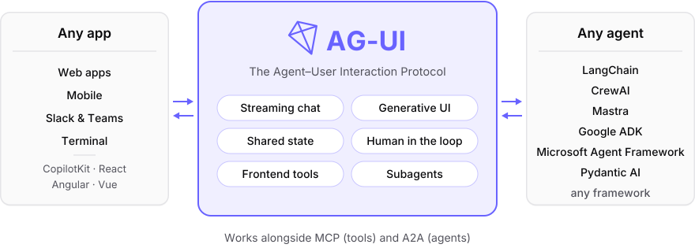
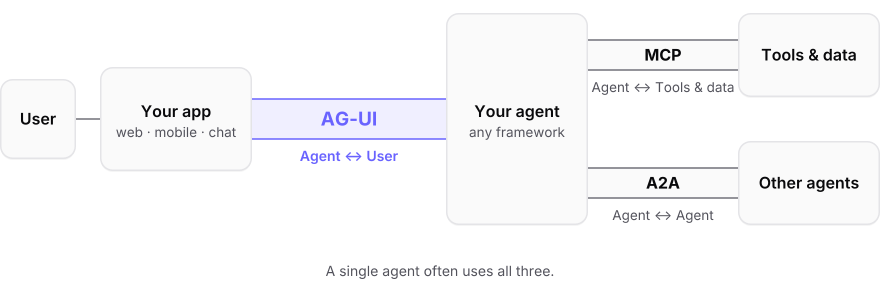
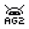

<div align="center">

<a href="https://docs.ag-ui.com"></a>

### The open protocol that connects any agent to any app.

<a href="https://www.npmjs.com/package/@ag-ui/core"></a>
<a href="https://www.npmjs.com/package/@ag-ui/core"></a>
<a href="https://pypi.org/project/ag-ui-protocol/"></a>
<a href="https://discord.gg/Jd3FzfdJa8"></a>
<a href="LICENSE"></a>

**[Docs](https://docs.ag-ui.com)** · **[Examples](https://dojo.ag-ui.com)** · **[Spec](https://docs.ag-ui.com/spec/1.0)** · **[Discord](https://discord.gg/Jd3FzfdJa8)**

<a href="https://docs.ag-ui.com/talk-to-us"></a>

<a href="https://trendshift.io/repositories/27961?utm_source=repository-badge&utm_medium=badge&utm_campaign=badge-repository-27961"></a>

</div>

<br>

**AG-UI is an open, lightweight, event-based protocol that standardizes how AI agents connect to user-facing applications.**

Agents don't fit the request/response model. They stream tokens, call tools mid-response, update shared state, pause for a human, and spawn subagents, and every framework does it differently. AG-UI replaces that custom wiring with one bi-directional event stream: the agent emits typed events, and any client can render them, no matter which framework built the agent. The same agent can power a web app, a mobile app, a terminal, or Slack.

<a href="https://docs.ag-ui.com"></a>

> [!IMPORTANT]
> **AG-UI 1.0 is here.** The protocol now has a stable, frozen [specification](https://docs.ag-ui.com/spec/1.0) backed by a JSON Schema, and the TypeScript, Python, and .NET SDKs are generated from it. 1.0 is backwards compatible in both directions: 0.x agents work with 1.0 clients and vice versa. [What changed →](https://docs.ag-ui.com/spec/1.0/changelog) · [Migration guide →](https://docs.ag-ui.com/migrating-to-1-0)

## Quick start

**Start a new app.** The CLI scaffolds a frontend ([CopilotKit](https://github.com/CopilotKit/CopilotKit) on Next.js, or a terminal client) wired to the agent framework you pick:

```bash
npx create-ag-ui-app@latest
```

Then follow the printed next steps. The generated templates call OpenAI, so set your key before `npm run dev`:

```bash
export OPENAI_API_KEY="sk-..."
```

<details>
<summary><b>Or speak the protocol directly: a 30-line agent server and client</b></summary>
<br>

An AG-UI agent is any HTTP endpoint that accepts a `RunAgentInput` and streams events back. No API keys needed for this one.

**1. The agent (Python).** Requires Python 3.9+.

```bash
pip install ag-ui-protocol fastapi uvicorn
```

```python
# server.py
import uuid

from fastapi import FastAPI, Request
from fastapi.responses import StreamingResponse
from ag_ui.core import (
    PROTOCOL_VERSION,
    RunAgentInput,
    RunStartedEvent,
    RunFinishedEvent,
    TextMessageStartEvent,
    TextMessageContentEvent,
    TextMessageEndEvent,
)
from ag_ui.encoder import EventEncoder

app = FastAPI()

@app.post("/")
async def run_agent(input_data: RunAgentInput, request: Request):
    encoder = EventEncoder(accept=request.headers.get("accept"))

    async def events():
        yield encoder.encode(RunStartedEvent(
            thread_id=input_data.thread_id,
            run_id=input_data.run_id,
            protocol_version=PROTOCOL_VERSION,
        ))
        message_id = str(uuid.uuid4())
        yield encoder.encode(TextMessageStartEvent(message_id=message_id, role="assistant"))
        for chunk in ["Hello ", "from ", "AG-UI!"]:
            yield encoder.encode(TextMessageContentEvent(message_id=message_id, delta=chunk))
        yield encoder.encode(TextMessageEndEvent(message_id=message_id))
        yield encoder.encode(RunFinishedEvent(thread_id=input_data.thread_id, run_id=input_data.run_id))

    return StreamingResponse(events(), media_type=encoder.get_content_type())
```

```bash
uvicorn server:app --port 8000
```

**2. The client (TypeScript).** In a second terminal, in a new folder. Requires Node.js 20+.

```bash
npm init -y && npm pkg set type=module
npm install @ag-ui/client tsx
```

```ts
// client.ts
import { HttpAgent } from "@ag-ui/client";

const agent = new HttpAgent({ url: "http://localhost:8000/" });

agent.addMessage({ id: crypto.randomUUID(), role: "user", content: "Hi there!" });

await agent.runAgent({}, {
  onRunStartedEvent: ({ event }) => console.log(`run started (AG-UI ${event.protocolVersion})`),
  onTextMessageContentEvent: ({ event }) => { process.stdout.write(event.delta); },
  onRunFinishedEvent: () => console.log("\nrun finished"),
});
```

```bash
npx tsx client.ts
```

You should see `Hello from AG-UI!` stream in. Swap the server for any [supported framework](#integrations) and the client doesn't change.

</details>

## Where AG-UI fits



AG-UI is one of three open, complementary agentic protocols. **MCP** gives agents tools and context, **A2A** lets agents work with other agents, and **AG-UI** brings agents to users. A single agent often uses all three, and AG-UI can front agents that speak MCP or A2A. [Read more →](https://docs.ag-ui.com/agentic-protocols)

> [!NOTE]
> **AG-UI or A2UI?** They work together. [A2UI](https://github.com/google/A2UI), MCP Apps, and Open-JSON-UI are *generative UI specs*: they describe what UI an agent wants to show. AG-UI is the *runtime protocol* that carries those payloads, along with everything else, between the agent and the app. [Learn more →](https://docs.ag-ui.com/concepts/generative-ui-specs)

## How it works


Your app starts a run by sending the agent a single `RunAgentInput`: the conversation, the tools the frontend offers, shared state, and context. The agent answers with a stream of typed events from eight families: run lifecycle, text messages, tool calls, state, reasoning, activity, subagents, and custom events ([full list](#event-reference)). Only the run lifecycle is required, so a minimal agent emits a handful of events and grows from there.

AG-UI is transport-agnostic. The spec defines [HTTP + SSE](https://docs.ag-ui.com/spec/1.0/basic/transports/http-sse) and a binary [HTTP + Protobuf](https://docs.ag-ui.com/spec/1.0/basic/transports/http-protobuf) binding, and middleware can adapt events from any source. Read the [architecture overview](https://docs.ag-ui.com/concepts/architecture) for the full picture.

## Features: what you can build

Each building block maps to events in the spec, and each has a live demo in the [AG-UI Dojo](https://dojo.ag-ui.com).

| Building block | What it does | Try it |
| --- | --- | --- |
| **Streaming chat** | Token-by-token messages across multi-turn sessions, with cancel and resume | [Demo](https://dojo.ag-ui.com/langgraph-fastapi/feature/agentic_chat) |
| **Generative UI** | Agents render typed components, or declarative UI with [A2UI](https://github.com/google/A2UI) and MCP Apps | [Demo](https://dojo.ag-ui.com/langgraph-fastapi/feature/tool_based_generative_ui) |
| **Shared state** | A typed store the agent and app both read and write, synced with snapshots and JSON Patch deltas | [Demo](https://dojo.ag-ui.com/langgraph-fastapi/feature/shared_state) |
| **Frontend tools** | The agent calls tools that run in the app, and gets the result back | [Demo](https://dojo.ag-ui.com/langgraph-fastapi/feature/human_in_the_loop) |
| **Human in the loop** | Runs end with an `interrupt` outcome; the user approves, edits, or rejects, and the next run resumes | [Demo](https://dojo.ag-ui.com/mastra/feature/interrupt) |
| **Reasoning** | Show the agent's reasoning as it works, including encrypted reasoning round-trips | [Demo](https://dojo.ag-ui.com/langgraph-fastapi/feature/agentic_chat_reasoning) |
| **Subagents** | Nested delegation, with every event attributed to the subagent run that produced it | [Demo](https://dojo.ag-ui.com/langgraph-fastapi/feature/deepagents_subagents) |
| **Multimodal** | Images, audio, video, and documents in user input and tool results | [Demo](https://dojo.ag-ui.com/langgraph-fastapi/feature/agentic_chat_multimodal) |

Tool output streaming, backend tool rendering, activity progress, token usage, and custom events are covered in the [docs](https://docs.ag-ui.com/concepts/events). Here's a quick tour of the Dojo:

https://github.com/user-attachments/assets/c298eea8-3f39-4a94-b968-7712429b0c49

## Integrations

AG-UI is adopted by Google, Microsoft, Amazon, and Oracle, and built into most agent frameworks. Every framework below has a live demo in the [Dojo](https://dojo.ag-ui.com).

<table>
  <tr>
    <td align="center" valign="top" width="25%"><br><b>LangChain</b><br><sub><a href="https://docs.copilotkit.ai/langgraph/">Docs</a> · <a href="https://dojo.ag-ui.com/langgraph-fastapi/feature/agentic_chat">Demo</a></sub></td>
    <td align="center" valign="top" width="25%"><br><b>CrewAI</b><br><sub><a href="https://docs.copilotkit.ai/crewai-flows">Docs</a> · <a href="https://dojo.ag-ui.com/crewai/feature/agentic_chat">Demo</a></sub></td>
    <td align="center" valign="top" width="25%"><br><b>Microsoft Agent Framework</b><br><sub><a href="https://docs.copilotkit.ai/microsoft-agent-framework">Docs</a> · <a href="https://dojo.ag-ui.com/microsoft-agent-framework-python/feature/agentic_chat">Demo</a></sub></td>
    <td align="center" valign="top" width="25%"><br><b>Google ADK</b><br><sub><a href="https://docs.copilotkit.ai/adk">Docs</a> · <a href="https://dojo.ag-ui.com/adk-middleware/feature/agentic_chat">Demo</a></sub></td>
  </tr>
  <tr>
    <td align="center" valign="top" width="25%"><br><b>AWS Strands Agents</b><br><sub><a href="https://docs.copilotkit.ai/aws-strands">Docs</a> · <a href="https://dojo.ag-ui.com/aws-strands/feature/agentic_chat">Demo</a></sub></td>
    <td align="center" valign="top" width="25%"><br><b>Mastra</b><br><sub><a href="https://docs.copilotkit.ai/mastra/">Docs</a> · <a href="https://dojo.ag-ui.com/mastra/feature/agentic_chat">Demo</a></sub></td>
    <td align="center" valign="top" width="25%"><br><b>Pydantic AI</b><br><sub><a href="https://docs.copilotkit.ai/pydantic-ai/">Docs</a> · <a href="https://dojo.ag-ui.com/pydantic-ai/feature/agentic_chat">Demo</a></sub></td>
    <td align="center" valign="top" width="25%"><br><b>LlamaIndex</b><br><sub><a href="https://docs.copilotkit.ai/llamaindex/">Docs</a> · <a href="https://dojo.ag-ui.com/llama-index/feature/agentic_chat">Demo</a></sub></td>
  </tr>
  <tr>
    <td align="center" valign="top" width="25%"><br><b>Agno</b><br><sub><a href="https://docs.copilotkit.ai/agno/">Docs</a> · <a href="https://dojo.ag-ui.com/agno/feature/agentic_chat">Demo</a></sub></td>
    <td align="center" valign="top" width="25%"><br><b>AG2</b><br><sub><a href="https://docs.copilotkit.ai/ag2/">Docs</a> · <a href="https://dojo.ag-ui.com/ag2/feature/agentic_chat">Demo</a></sub></td>
    <td align="center" valign="top" width="25%"><br><b>Claude Agent SDK</b><br><sub><a href="integrations/claude-agent-sdk">Docs</a> · <a href="https://dojo.ag-ui.com/claude-agent-sdk-python/feature/agentic_chat">Demo</a></sub></td>
    <td align="center" valign="top" width="25%"><br><b><a href="https://docs.ag-ui.com/integrations">+11 more</a></b><br><sub>Antigravity, OpenAI Agents, watsonx, Spring AI, and others in the <a href="#full-list-of-integrations">full list</a></sub></td>
  </tr>
</table>

**Protocols:** [A2A](https://docs.copilotkit.ai/a2a-protocol) · [MCP](middlewares/mcp-middleware) · [MCP Apps](https://docs.copilotkit.ai/generative-ui-specs/mcp-apps) · [A2UI](middlewares/a2ui-middleware)\
**Clients:** [CopilotKit](https://github.com/CopilotKit/CopilotKit) (React, Angular, Vue, React Native) · [Slack & Teams](https://github.com/CopilotKit/channels-sdk) · [Terminal](https://docs.ag-ui.com/quickstart/clients) · [OpenBot](https://open.bot/builders)

Don't see your framework? [Build an integration →](https://docs.ag-ui.com/quickstart/introduction)

### Full list of integrations

<details>
<summary><b>Show all integrations</b></summary>
<br>

- **Partners:** [LangChain](https://docs.copilotkit.ai/langgraph/) · [CrewAI](https://docs.copilotkit.ai/crewai-flows)
- **Built in:** [Microsoft Agent Framework](https://docs.copilotkit.ai/microsoft-agent-framework) · [Google ADK](https://docs.copilotkit.ai/adk) ([JS](https://docs.ag-ui.com/integrations/google-adk-js)) · [Google Antigravity](https://docs.copilotkit.ai/google-antigravity) · [AWS Strands Agents](https://docs.copilotkit.ai/aws-strands) · [Mastra](https://docs.copilotkit.ai/mastra/) · [Pydantic AI](https://docs.copilotkit.ai/pydantic-ai/) · [Agno](https://docs.copilotkit.ai/agno/) · [LlamaIndex](https://docs.copilotkit.ai/llamaindex/) · [AG2](https://docs.copilotkit.ai/ag2/)
- **More frameworks:** [Claude Agent SDK](integrations/claude-agent-sdk) · [Claude Managed Agents](integrations/claude-managed-agents) · [IBM watsonx Orchestrate](integrations/watsonx) · [Langroid](integrations/langroid) · [Spring AI](integrations/community/spring-ai) · [Cloudflare Agents](integrations/community/cloudflare-agents) · [Omnara](https://docs.ag-ui.com/integrations/omnara) · [Genkit (Go)](integrations/community/genkit/go) · [OpenAI Agents](integrations/openai-agents)
- **Specs:** [Oracle Agent Spec](https://go.copilotkit.ai/copilotkit-oracle-docs)
- **Deployment:** [Amazon Bedrock AgentCore](https://docs.aws.amazon.com/bedrock-agentcore/latest/devguide/runtime-agui.html)

Source for every integration lives in [`integrations/`](integrations) and [`middlewares/`](middlewares), and the demos in [`apps/dojo`](apps/dojo).

</details>

## SDKs

| Language | Install | Reference |
| --- | --- | --- |
| **TypeScript** | `npm install @ag-ui/client` | [Docs](https://docs.ag-ui.com/sdk/js/core/overview) · [Source](sdks/typescript) |
| **Python** | `pip install ag-ui-protocol` | [Docs](https://docs.ag-ui.com/sdk/python/core/overview) · [Source](sdks/python) |
| **.NET** | `dotnet add package AGUI.Client` | [Docs](https://docs.ag-ui.com/sdk/dotnet/client/overview) · [Source](sdks/dotnet) |

**Community SDKs:** [Kotlin](sdks/community/kotlin) · [Go](sdks/community/go) · [Java](sdks/community/java) · [Dart](sdks/community/dart) · [Rust](sdks/community/rust) · [Ruby](sdks/community/ruby) · [C++](sdks/community/c++) · [Swift](sdks/community/swift)

## Event reference

AG-UI 1.0 defines 31 event types in eight families. See the [spec](https://docs.ag-ui.com/spec/1.0/events) for every field.

| Event family | Events |
| --- | --- |
| [Runs and steps](https://docs.ag-ui.com/spec/1.0/events/lifecycle) | `RUN_STARTED` `RUN_FINISHED` `RUN_ERROR` `STEP_STARTED` `STEP_FINISHED` |
| [Text messages](https://docs.ag-ui.com/spec/1.0/events/text-messages) | `TEXT_MESSAGE_START` `TEXT_MESSAGE_CONTENT` `TEXT_MESSAGE_END` `TEXT_MESSAGE_CHUNK` |
| [Tool calls](https://docs.ag-ui.com/spec/1.0/events/tool-calls) | `TOOL_CALL_START` `TOOL_CALL_ARGS` `TOOL_CALL_END` `TOOL_CALL_RESULT` `TOOL_CALL_CHUNK` |
| [State](https://docs.ag-ui.com/spec/1.0/events/state) | `STATE_SNAPSHOT` `STATE_DELTA` (JSON Patch) `MESSAGES_SNAPSHOT` |
| [Reasoning](https://docs.ag-ui.com/spec/1.0/events/reasoning) | `REASONING_START` `REASONING_MESSAGE_*` `REASONING_ENCRYPTED_VALUE` `REASONING_END` |
| [Activity](https://docs.ag-ui.com/spec/1.0/events/activity) | `ACTIVITY_SNAPSHOT` `ACTIVITY_DELTA` |
| [Subagents](https://docs.ag-ui.com/spec/1.0/events/subagents) | `SUBAGENT_STARTED` `SUBAGENT_FINISHED` `SUBAGENT_ERROR` |
| [Passthrough](https://docs.ag-ui.com/spec/1.0/events/passthrough) | `RAW` `CUSTOM` |

## Community

- **Questions and ideas:** [Discord](https://discord.gg/Jd3FzfdJa8) and [GitHub Discussions](https://github.com/ag-ui-protocol/ag-ui/discussions)
- **Bugs:** [GitHub Issues](https://github.com/ag-ui-protocol/ag-ui/issues)
- **What's next:** the [roadmap](https://github.com/orgs/ag-ui-protocol/projects/1) and the [draft spec](https://docs.ag-ui.com/spec/draft)

## Contributing

Contributions are welcome: new integrations, SDKs, docs, and fixes. Start with [CONTRIBUTING.md](CONTRIBUTING.md), and use the [server starter](integrations/server-starter) and [middleware starter](middlewares/middleware-starter) as templates for new integrations. Report security issues as described in [SECURITY.md](SECURITY.md).

AG-UI was created by [CopilotKit](https://copilotkit.ai) and is developed in the open with the community.

## License

AG-UI is open source under the [MIT License](LICENSE).
