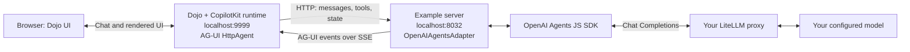
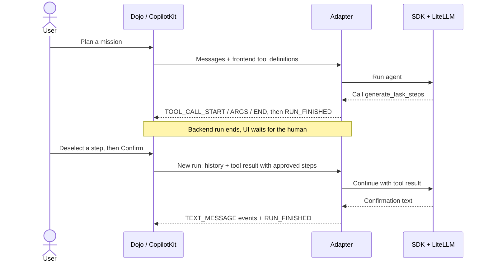
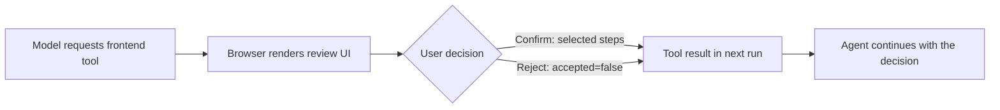

# OpenAI Agents JS: local demo runbook

**Goal:** show a real model driving five Dojo experiences through AG-UI.
Allow about 10 minutes for the presentation, plus installation/build time.
Commands below use Bash, from this repository's checkout.

## 1. Understand the pieces



**Talk track:** "The SDK runs the agent. Our adapter translates its events into
AG-UI. Dojo turns those events into chat, tool cards, and shared state."

The thin `HttpAgent` connects to our server; it does not run the OpenAI SDK.
The LiteLLM key belongs in the backend shell, never in browser code.

## 2. Install and build once

Use Node.js 24 LTS and pnpm 10.33.4 (the versions used for local validation).
You need a LiteLLM model route that supports **streaming and function tools**.
No Python server, OpenAI cloud account, or Playwright install is needed for
these manual flows.

From the repository root:

```bash
node --version
pnpm --version
pnpm install --frozen-lockfile
pnpm exec nx run-many -t build --projects=@ag-ui/openai-agents-js,demo-viewer
```

Use a full workspace install, not a filtered install: Dojo builds other
integration packages too. Rebuild after changing frontend code.

## 3. Terminal A: configure LiteLLM and start the backend

From the repository root, replace the URL and model alias with your values:

```bash
export OPENAI_BASE_URL='https://your-litellm-host.example/v1'
export OPENAI_MODEL='your-proxy-model-alias'
read -rsp 'LiteLLM key: ' OPENAI_API_KEY; printf '\n'
export OPENAI_API_KEY

pnpm --dir integrations/openai-agents-js exec tsx examples/server.ts
```

- Use the proxy's API base URL, usually ending in `/v1`, **not**
  `/v1/chat/completions`. Use its exact model alias, not necessarily a provider name.
- `read -s` hides the key and keeps its value out of shell history. These
  variables last only in this shell and its child processes.
- `OPENAI_BASE_URL` selects Chat Completions mode and disables SDK tracing.
  Without it, the adapter can use OpenAI cloud instead.
- The backend defaults to port **8032**. If your shell already exports `PORT`,
  launch with `PORT=8032 pnpm --dir integrations/openai-agents-js exec tsx examples/server.ts`.
- Restart this process after changing the URL, key, or model.

**Do not use `run-dojo-everything.js --only dojo,openai-agents-js` for this live
demo:** that lane deliberately supplies a mock key and localhost mock endpoint.

## 4. Terminal B: start Dojo

In another terminal, from the same repository root:

```bash
export OPENAI_AGENTS_JS_URL='http://localhost:8032'
PORT=9999 pnpm exec nx run demo-viewer:start
```

Keep both terminals running. In a third terminal, check:

```bash
curl --fail http://localhost:8032/health
curl --fail --silent --output /dev/null \
  --write-out 'Dojo HTTP %{http_code}\n' http://localhost:9999
```

Expect `{"status":"healthy","agents":5}` and `Dojo HTTP 200`.
The health check confirms the server is up, **not** LiteLLM authentication.
The first chat prompt below checks the complete path.

Open [Agentic Chat](http://localhost:9999/openai-agents-js/feature/agentic_chat).
Use this direct link: production mode hides local-only integrations from the
integration dropdown, including this JS integration. The page still shows
**OpenAI Agents SDK (JavaScript/TypeScript)** as the current integration and
provides its five demo links.
Open the chat panel if it is collapsed.

To make the integration selectable in the dropdown, stop only your Dojo process
with **Ctrl+C** in Terminal B and run development mode instead:

```bash
PORT=9999 pnpm exec nx run demo-viewer:dev
```

Keep Terminal A running and retain `OPENAI_AGENTS_JS_URL` in Terminal B.
Development mode shows local-only integrations; the first page load can take
longer while Next.js compiles it. Do not set `NODE_ENV` manually.

## 5. Present the five flows

Use the links below or the Dojo menu. Wait for each response to finish before
sending another prompt. Real model wording varies; check the behavior, not an
exact sentence. Reload a scenario page to start a fresh conversation.

### A. Agentic chat: streaming and conversation

[Open chat](http://localhost:9999/openai-agents-js/feature/agentic_chat)

1. Send: **"My demo project is called Lighthouse. Explain AG-UI in two sentences."**
2. Send: **"What is my demo project called?"**
3. Check: text streams into chat; the second reply remembers Lighthouse.

Say: "The frontend sends history with each run; this is not a separate hosted
conversation database."

### B. Backend tool: a server function with a UI card

[Open backend tools](http://localhost:9999/openai-agents-js/feature/backend_tool_rendering)

1. Send: **"Use get_weather for San Francisco."**
2. Check: a weather card appears, followed by an answer.
3. Explain: `get_weather` runs on the server and returns **sample** weather:
   temperature 20, sunny. It is not a live weather service.

Say: "The model chooses the tool. Our server executes it. AG-UI carries the
arguments and result so the UI can render them."

### C. Human in the loop: approve only selected steps

[Open human approval](http://localhost:9999/openai-agents-js/feature/human_in_the_loop)

1. Send: **"Plan a mission to Mars in three steps. Make the first step Start The Planning."**
2. Check: an interactive step list appears with **Confirm** and **Reject**.
3. Deselect **Start The Planning**, then click **Confirm**.
4. Check: the selection changes, approval is recorded, and the assistant resumes.
5. Reload, request another plan, and click **Reject**. Check that the assistant
   receives the rejection rather than an approval.

This is a planning demo; no spacecraft is launched and no real tasks execute.
The model's continuation should reflect the decision.



For this CopilotKit demo, `interruptOnFrontendToolCall: false` finishes the
backend run successfully while the UI manages the pending approval. This is
still a halt/resume flow; it does not auto-approve the tool.

### D. Generative UI: model arguments become a component

[Open generative UI](http://localhost:9999/openai-agents-js/feature/tool_based_generative_ui)

1. Send: **"Generate a haiku about the moon shining bright. Use generate_haiku."**
2. Check: a formatted haiku card appears, not just plain chat text.
3. Send: **"Now generate a different haiku about a mountain sunrise."**
4. Check: a second/different haiku renders and the conversation remains usable.

Say: "The model supplies structured arguments. A frontend tool renders a
predefined component; the model is not sending arbitrary React code."

### E. Shared state: edit a recipe together

[Open shared state](http://localhost:9999/openai-agents-js/feature/shared_state)

1. Send: **"Create a beginner pasta recipe for two with Pasta and Tomato Sauce.
   Update the shared recipe using ag_ui_update_state."**
2. Check: the recipe form fills with ingredients and instructions.
3. In the form, rename an ingredient to **Cherry Tomatoes**.
4. Send: **"Keep Cherry Tomatoes and the other ingredients. Add basil and update
   the full shared recipe."**
5. Check: the UI edit is preserved and basil appears.

Say: "The browser sends current state to the agent. The adapter converts
`ag_ui_update_state` into a `STATE_SNAPSHOT`, replacing the full recipe state."

## 6. Spotlight: tool calls and approval in the frontend

Use these two demos back-to-back to explain the difference:

| Demo | Tool owner | What the audience sees | Human approval? |
|---|---|---|---|
| Weather | Backend: `get_weather` | Server result rendered as a weather card | No |
| Haiku | Frontend: `generate_haiku` | Browser handler adds a card to the carousel | No |
| Task plan | Frontend: `generate_task_steps` | Editable step list, then Confirm or Reject | Yes |

Rendering a backend result in the browser does **not** make it a frontend tool.

### Show a frontend tool call: haiku

1. Open the [haiku page](http://localhost:9999/openai-agents-js/feature/tool_based_generative_ui)
   and DevTools **Network**. Clear the request list.
2. Send: **"Use generate_haiku to make a haiku about a mountain sunrise."**
3. Open the run request under `/api/copilotkit/openai-agents-js`. In its response
   or EventStream view, find `TOOL_CALL_START` with `toolCallName: "generate_haiku"`,
   then `TOOL_CALL_ARGS` and `TOOL_CALL_END`. Correlate them by `toolCallId`.
4. Point out the generated text, image name, and gradient in the arguments,
   then show those values rendered in the card.
5. Show [the frontend implementation](../../apps/dojo/src/app/[integrationId]/feature/(v2)/tool_based_generative_ui/page.tsx):
   search for `useFrontendTool` and `name: "generate_haiku"`.
   Its `handler` calls `setHaikus(...)`; its `render` returns `HaikuCard`.

Say: "The model requests a named operation with JSON arguments. Our browser
code decides what that operation does. Here, it updates React state."

This tool has `followUp: false`: after rendering, it does not need another
model run just to acknowledge the card. Do not expect a backend
`TOOL_CALL_RESULT` event for this browser-executed tool.

### Show approval: pause, edit, confirm, resume

1. Open the [approval page](http://localhost:9999/openai-agents-js/feature/human_in_the_loop)
   and request the three-step Mars plan from scenario C.
2. **Before clicking anything**, show that the assistant is waiting on the
   selection UI. The initial backend run has ended; it is not holding a model
   connection open while you decide.
3. Deselect the first step. Explain: "We can edit the selection returned in
   the tool result, not just say yes or no. The original model arguments stay
   in the history."
4. Clear Network, click **Confirm**, and open the new **run** request.
   In its message history, find the tool-role result for the earlier call.
   Its content should represent this shape (descriptions may vary):

   ```json
   {
     "accepted": true,
     "steps": [
       { "description": "Design spacecraft", "status": "enabled" },
       { "description": "Launch mission", "status": "enabled" }
     ]
   }
   ```

5. Check that the deselected step is absent from the returned `steps`. Show
   the assistant's follow-up response.
6. Reload and repeat with **Reject**. The returned result is
   `{"accepted": false}`. The assistant should acknowledge the rejection,
   not claim the plan was approved.
7. Show [the approval UI implementation](../../apps/dojo/src/app/[integrationId]/feature/(v2)/human_in_the_loop/page.tsx):
   search for `useHumanInTheLoop`, `handleConfirm`, and `handleReject`.
   Those handlers call `respond(...)` with the user's decision.



**Scope:** this demonstrates approval of a **frontend tool result**, not
SDK-native approval of a privileged backend operation such as issuing a refund.
The current five JS Dojo scenarios do not include that backend approval flow.
Real side effects still need server-side authorization and validation; a browser
confirmation alone is not a security boundary.

## 7. Presenter checklist and troubleshooting

- Rehearse all five flows with your actual LiteLLM model. The passing automated
  tests used mocks, not your proxy; live tool choices and latency can differ.
- Use synthetic prompts only. Prompts and state go to your proxy/model.
  Hide the backend terminal when screen sharing and never show the key.
- In browser DevTools, filter Network for `/api/copilotkit/openai-agents-js`.
  Inspect a **run** response to show the AG-UI stream; info requests are not runs.
- `401/403`: check the proxy URL/key and access policy. `404/model not found`:
  check the API base path and model alias. Check Terminal A for backend errors.
- Plain text instead of a card: confirm tool support and explicitly request the
  named tool. If the tool call is present but no card renders, inspect the run
  stream and browser console.
- Previous automated runs logged HTTP `405` on the runtime `/info` path while
  all five flows passed. Do not treat that warning alone as a failed agent run;
  investigate if the scenario itself fails.
- Port in use: stop your own old demo process; do not kill unrelated services.
- JS integration missing from the picker: production mode hides local-only
  integrations. Open the direct scenario URL above, or use development mode.
- Stop with **Ctrl+C** in both server terminals. In Terminal A, clear credentials:
  `unset OPENAI_API_KEY OPENAI_BASE_URL OPENAI_MODEL`.

**Closing line:** "One event protocol, five UI patterns, with the same OpenAI
Agents JS adapter and a replaceable inference endpoint."
